# Rasta Quest

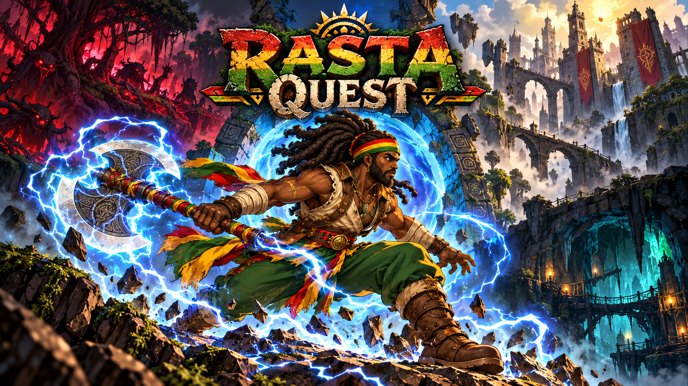

**Raízes ancestrais. Mundos em ruínas. Justiça através do trovão.**

Rasta Quest é um jogo de ação e plataforma em **2D**, com exploração lateral, combate de machado, poderes elétricos e progressão permanente. Akane Xangô atravessa Floresta Corrompida, Castelo Fraturado e Cavernas dos Ecos em jornadas conectadas por portais.

| Direção atual | Estado verificável |
|---|---|
| Android em paisagem · ilustração 2D detalhada | Pré-produção visual e preparação da migração Unity |
| Unity 6.3 / C# como alvo | Protótipo Godot preservado; editor Unity ainda não validado |
| Chefes e Santuário Ancestral também em 2D | Avaliação de 3D adiada |
| 21 pranchas de salas arquivadas | São referências de fases extensas, não salas já montadas na engine |

As artes desta retomada estão na branch do [PR #84](https://github.com/tupiniquimtechsolution-blip/RastaQuest/pull/84), em rascunho. Arquivo publicado em branch não significa integração na main, build Unity ou release.

## Bancada interativa antes do Unity

[Abrir instruções da bancada 2D](preunity/README.md): movimentos articulados, respostas de combate, árvore clicável, parallax e biblioteca sonora para avaliação local.

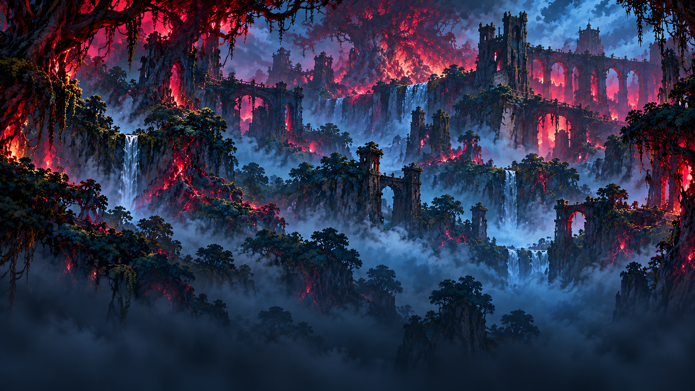

Esta etapa acrescenta **nove camadas de cenário, um modelo neutro de Akane e 16 SFX gerados** (12 pilotos + quatro gravações específicas de locomoção). [Registro das seis frentes](docs/production/PREUNITY_EXECUTION_2026-10-24.md) · [Expansão sonora, armas, dano/morte e ambientes](docs/production/audio_drafts/SFX_EVENT_MAPPING_2026-10-24.md).

O rig ainda é estrutural, sem arte vinculada aos ossos; as camadas precisam virar cenários jogáveis. Os sons aguardam audição e acabamento. O catálogo ampliado tem 84 cues: 16 arquivos gerados e 68 aguardando geração por indisponibilidade de créditos. A bancada permite buscar e filtrar os sons, incluindo as pendências.

## Árvore de habilidades — Raízes do Trovão

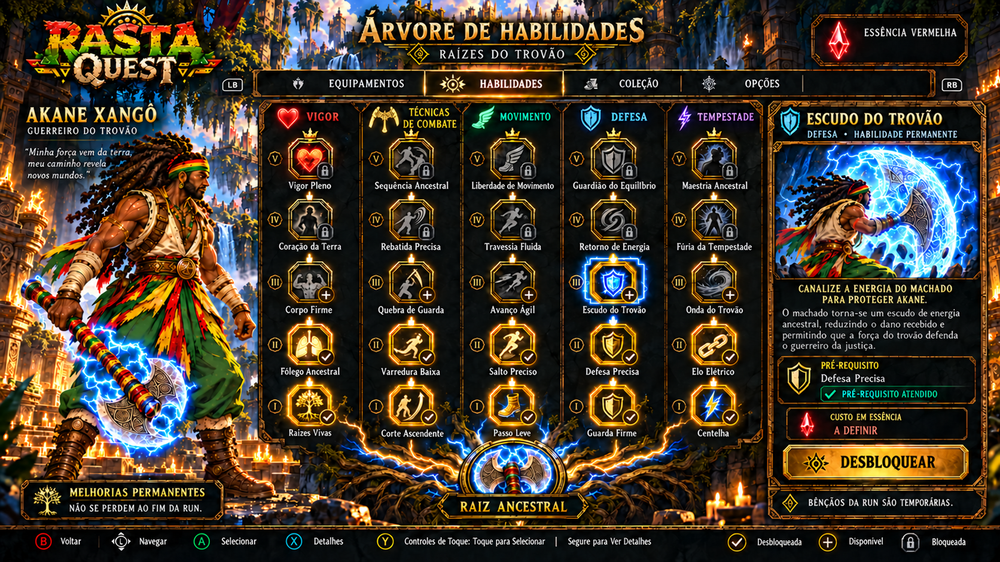

Cinco ramos e 25 habilidades propostas: **Vigor · Técnicas de Combate · Movimento · Defesa · Tempestade**.

**Equipamentos/Machado** concentra cabo, lâmina, ponteira e personalização da peça. **Técnicas de Combate** desenvolve Corte Ascendente, Varredura Baixa, Quebra de Guarda, Rebatida Precisa e Sequência Ancestral. A árvore não duplica a melhoria de equipamentos. Bênçãos da run continuam temporárias.

[Ver os cinco ramos em detalhe](assets/production_drafts/2026-10-24/skill-tree-v02/skill-tree-branches.png) · [Design e dependências](assets/production_drafts/2026-10-24/skill-tree-v02/README.md) · [Versão anterior preservada](assets/production_drafts/2026-10-24/skill-tree-v01/README.md)

## Movimentos com preparação, ação e recuperação

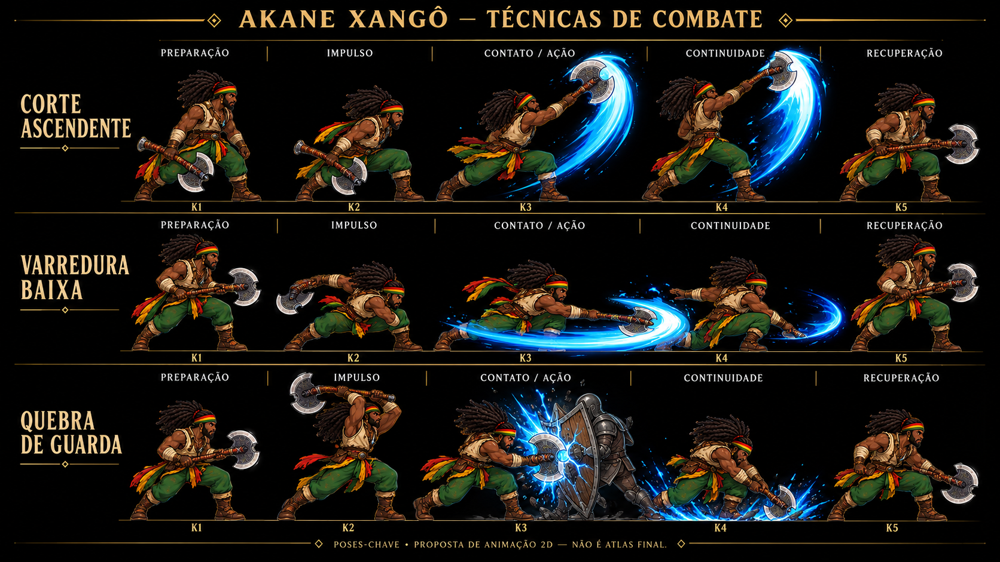

| Prancha | Estudos |
|---|---|
| [Técnicas](assets/production_drafts/2026-10-24/combat-motion-v01/poses-attacks.png) | Corte Ascendente · Varredura Baixa · Quebra de Guarda |
| [Defesas](assets/production_drafts/2026-10-24/combat-motion-v01/poses-defenses.png) | Defesa Precisa · Rebatida Precisa · Escudo do Trovão |
| [Mobilidade](assets/production_drafts/2026-10-24/combat-motion-v01/poses-mobility.png) | Avanço Ágil · Salto Preciso · Esquiva de Investida |
| [Trovão e sequências](assets/production_drafts/2026-10-24/combat-motion-v01/poses-storm.png) | Onda do Trovão · Fúria da Tempestade · Sequência Ancestral |

São **12 estudos e 60 poses-chave**, não clips finais ou atlas prontos. [Contrato de animação e próximos passos](assets/production_drafts/2026-10-24/combat-motion-v01/README.md).

Ver as outras três pranchas de movimentos

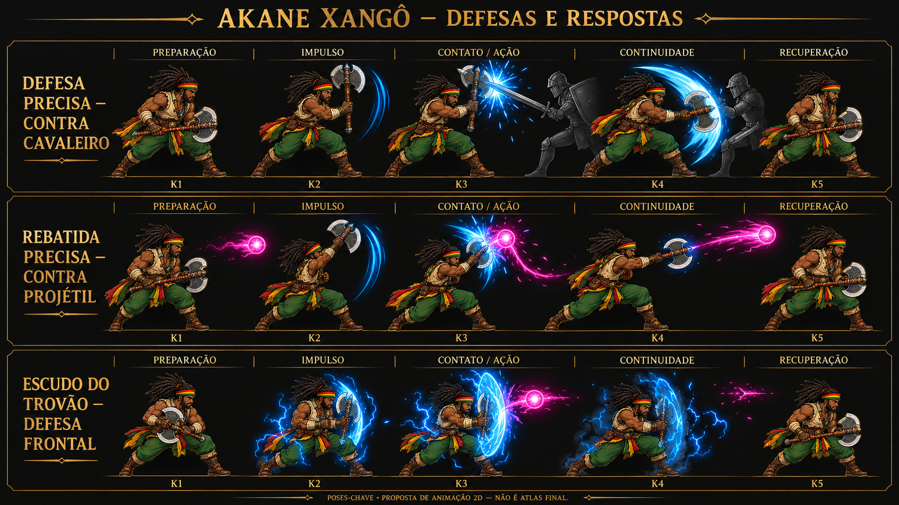

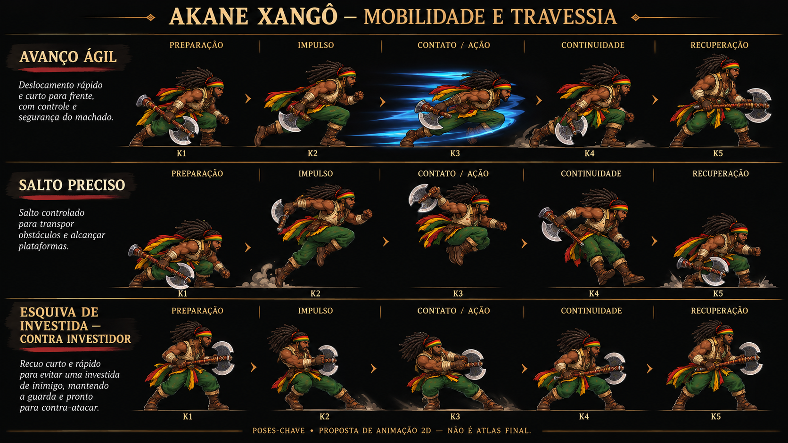

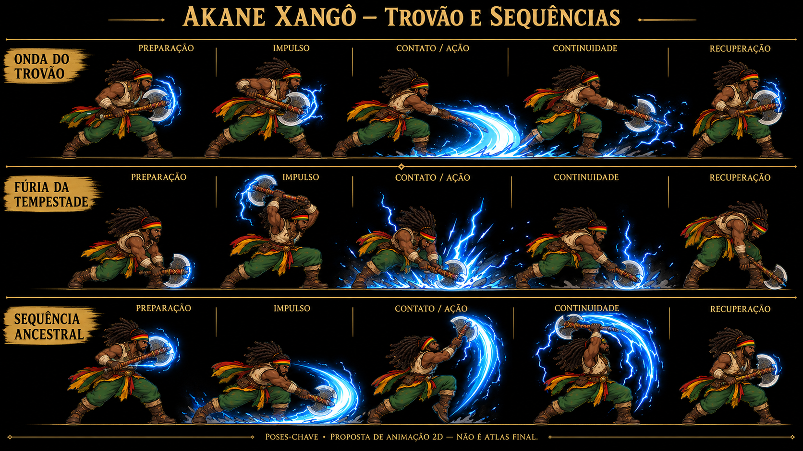

## Três biomas, 21 salas

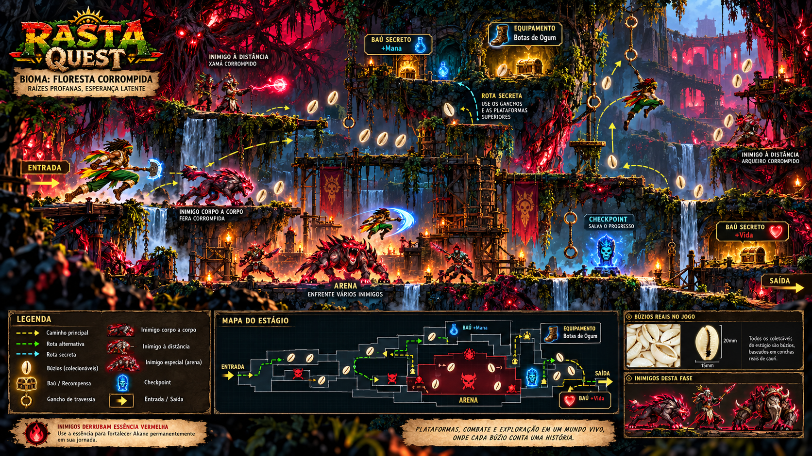

Cada bioma tem sete salas, com chefe na sétima. O mapa condensado preserva os marcos de uma travessia side-scrolling extensa; a implementação deve criar distância entre esses lugares. **Cinco búzios reais por sala concedem uma vida extra**, separados da coleção global.

| Sala | Floresta Corrompida | Castelo Fraturado | Cavernas dos Ecos |
|---|---|---|---|
| 01 | [Sala 01](assets/production_drafts/2026-10-24/recovered-chat-originals-v01/biomes/floresta/sala-01-original.png) | [Sala 01](assets/production_drafts/2026-10-24/recovered-chat-originals-v01/biomes/castelo/sala-01-portao-das-muralhas-quebradas.png) | [Sala 01](assets/production_drafts/2026-10-24/biome-continuation-v01/cavernas-01.png) |
| 02 | [Sala 02](assets/production_drafts/2026-10-24/recovered-chat-originals-v01/biomes/floresta/sala-02-ponte-das-raizes-profanadas.png) | [Sala 02](assets/production_drafts/2026-10-24/recovered-chat-originals-v01/biomes/castelo/sala-02-galeria-das-correntes-partidas.png) | [Sala 02](assets/production_drafts/2026-10-24/biome-continuation-v01/cavernas-02.png) |
| 03 | [Sala 03](assets/production_drafts/2026-10-24/recovered-chat-originals-v01/biomes/floresta/sala-03-viveiro-dos-xamas-corrompidos.png) | [Sala 03](assets/production_drafts/2026-10-24/recovered-chat-originals-v01/biomes/castelo/sala-03-salao-dos-arcos-caidos.png) | [Sala 03](assets/production_drafts/2026-10-24/biome-continuation-v01/cavernas-03.png) |
| 04 | [Sala 04](assets/production_drafts/2026-10-24/recovered-chat-originals-v01/biomes/floresta/sala-04-cascata-dos-ecos-de-pedra.png) | [Sala 04](assets/production_drafts/2026-10-24/recovered-chat-originals-v01/biomes/castelo/sala-04-torre-do-sino-rachado.png) | [Sala 04](assets/production_drafts/2026-10-24/biome-continuation-v01/cavernas-04.png) |
| 05 | [Sala 05](assets/production_drafts/2026-10-24/recovered-chat-originals-v01/biomes/floresta/sala-05-clareira-do-julgamento-de-ogum.png) | [Sala 05](assets/production_drafts/2026-10-24/biome-continuation-v01/reference-castelo-sala05.png) | [Sala 05](assets/production_drafts/2026-10-24/biome-continuation-v01/cavernas-05.png) |
| 06 | [Sala 06](assets/production_drafts/2026-10-24/recovered-chat-originals-v01/biomes/floresta/sala-06-coracao-da-arvore-profanada.png) | [Sala 06](assets/production_drafts/2026-10-24/biome-continuation-v01/castelo-06.png) | [Sala 06](assets/production_drafts/2026-10-24/biome-continuation-v01/cavernas-06.png) |
| 07 | [Sala 07](assets/production_drafts/2026-10-24/recovered-chat-originals-v01/biomes/floresta/sala-07-trono-da-raiz-julgadora.png) | [Sala 07](assets/production_drafts/2026-10-24/biome-continuation-v01/castelo-07.png) | [Sala 07](assets/production_drafts/2026-10-24/biome-continuation-v01/cavernas-07.png) |

[Originais recuperados](assets/production_drafts/2026-10-24/recovered-chat-originals-v01/README.md) · [Continuação do Castelo e Cavernas](assets/production_drafts/2026-10-24/biome-continuation-v01/README.md) · [Inventário das 21 salas](docs/production/BIOME_IMAGE_AUDIT_2026-10-24.json)

## Identidade, menus e mundo

| Menu principal | Equipamentos, atributos e poderes da run |
|---|---|
| 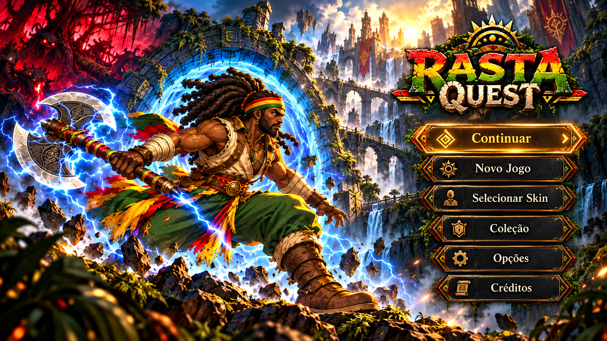 | 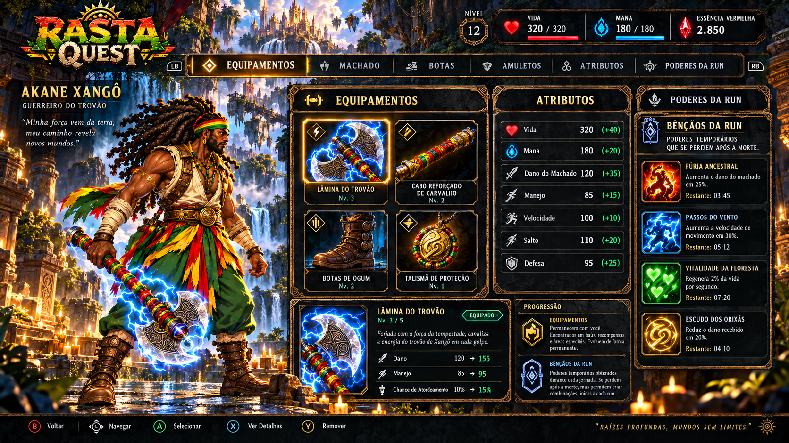 |

| Material | Referência |
|---|---|
| Ícone do jogo | [Ícone](assets/production_drafts/2026-10-24/recovered-chat-originals-v01/branding/icone-rasta-quest.png) |
| Carregamento e atualização | [Tela de referência](assets/production_drafts/2026-10-24/recovered-chat-originals-v01/ui/carregamento-atualizacao.png) |
| Lore de Akane Xangô | [Origem e mundo fragmentado](assets/production_drafts/2026-10-24/recovered-chat-originals-v01/world/lore-akane-xango.png) |
| Coletáveis e progressão | [Referência inicial](assets/production_drafts/2026-10-24/recovered-chat-originals-v01/systems/coletaveis-v01.png) · [Equipamentos e progressão](assets/production_drafts/2026-10-24/recovered-chat-originals-v01/systems/coletaveis-e-progressao-v02.png) |
| Personagens e inimigos | [Akane](assets/production_drafts/2026-10-24/recovered-chat-originals-v01/characters/akane-xango-animation-sheet.png) · [Cavaleiro](assets/production_drafts/2026-10-24/recovered-chat-originals-v01/enemies/cavaleiro-corrompido-animation-sheet.png) · [Arcanista](assets/production_drafts/2026-10-24/recovered-chat-originals-v01/enemies/arcanista-animation-sheet.png) |
| Skins de personagem e machado | [Prancha de coleção](assets/production_drafts/2026-10-24/recovered-chat-originals-v01/systems/skins-premium.png) |

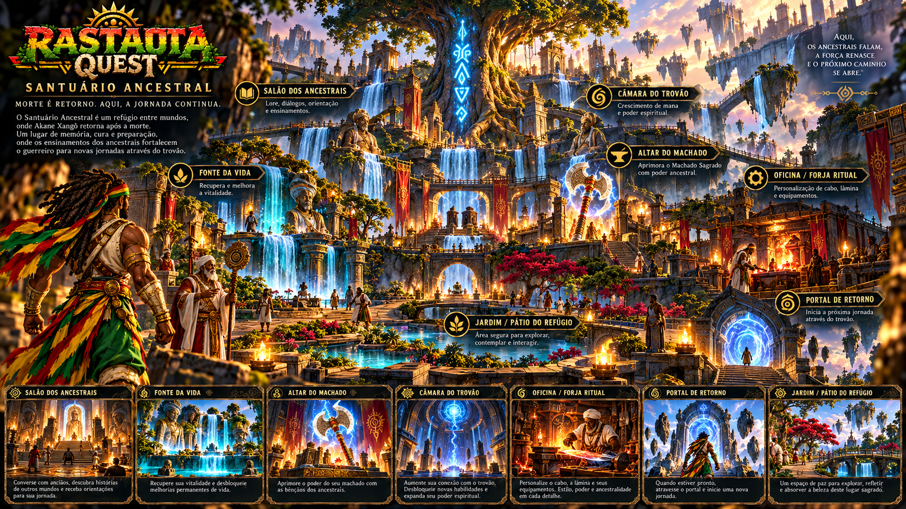

Os originais enviados pelo usuário continuam preservados com nomes recebidos, destinos organizados e hashes. A biblioteca serve à direção visual e a peças promocionais; conceitos e mockups não devem ser apresentados como capturas de gameplay implementado.

## O que podemos produzir antes do Unity

1. Modelo/rig 2D consistente e quadros intermediários das animações.
2. Reações de inimigos, transições e animatics de confronto.
3. Especificação das habilidades, pré-requisitos e equilíbrio a definir.
4. Biblioteca de efeitos sonoros: plano de **42 cues**, começando com **12 para teste**.
5. Camadas de bioma, VFX, interface adaptável, textos e material promocional.

[Plano priorizado de visual, animação e áudio](docs/production/PREUNITY_VISUAL_AUDIO_PLAN_2026-10-24.md) · [Catálogo planejado de SFX](docs/production/audio_drafts/SFX_CUE_PLAN_2026-10-24.json)

Áudio ainda não foi gerado nesta etapa. Importação, funcionamento no Unity e desempenho no aparelho exigem validação posterior. Revisões artística, cultural, de direitos e de acessibilidade permanecem gates de produção.

## Para desenvolvimento

| Diretório | Finalidade |
|---|---|
| assets/production_drafts/ | Pranchas, estudos, referências e procedência |
| docs/production/ | Especificações visuais, inventários e preparação |
| unity/ | Projeto Unity de revisão, sem comprovação de compilação nesta entrega |
| game/ | Protótipo Godot preservado |
| tools/ | Verificadores e ferramentas existentes |
| docs/legacy/ | Fontes e documentos históricos |

Referências técnicas: [cânone](docs/product/GAME_CANON.md), [arquitetura](docs/architecture/TECHNICAL_ARCHITECTURE.md), [roadmap](docs/roadmap/MASTER_RELEASE_PLAN.md), [critérios de release](docs/release/RELEASE_CRITERIA.md), [pipeline de arte](docs/production/ART_PIPELINE.md), [estado do projeto](docs/status/CURRENT_STATE.md), [direção Unity](docs/production/UNITY_DIRECTION_2026-10-24.md) e [projeto Unity](unity/README.md).

O material bruto histórico está preservado em [docs/source/RASTA_QUEST_RAW.md](docs/source/RASTA_QUEST_RAW.md). Instruções para agentes estão em [AGENTS.md](AGENTS.md). Portal's Edge e PortalAscendant são nomes históricos; o produto atual é **Rasta Quest**.
