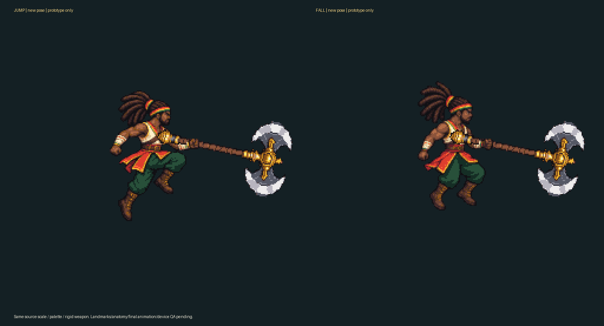

# Salto / queda — duas poses novas em revisão

O alvo de aparência é o aprovado por Rodrigo em22/10 (registro em ../axe-idle-2x/OWNER_APPEARANCE_APPROVAL.json). Estas duas novas poses não receberam aceite final. São dois desenhos gerados desarmados, não recortes do idle nem animações inventadas a partir de sua pose estática.

## Arquivos e método

Fontes ImageGen1254×1254, prompts completos, corpo/arma/oclusão da mão em PNGs separados, exports compostos256×256, manifesto de origem/pega/pelve/pés e verificação. Ambos usam **o mesmo fator fixo de redução24/140**, paleta32 do alvo anterior, alpha binário e renderização pretendida0.5. A fonte generativa não entregou sprites nativos; a redução/reconstrução está explícita em build_airborne.py. Marcos de pelve/pega são estimados no desenho e continuam sujeitos à revisão de anatomia.

O machado é o mesmo arquivo rígido do pacote anterior; a lâmina não sobrepõe o corpo, e a pega cai dentro da mão opaca. O punho fornece uma camada de oclusão sobre o cabo. Não houve escala diferente da arma por pose. A origem permanece128,128 e a pelve de referência130,120; os pés **não** foram alinhados artificialmente ao chão: borda y181 no salto e y172 na queda, deslocamentos+1/-8pixels da referência180. Esses são marcos locais do desenho, não posições físicas de salto.

As poses são referências de um quadro para os estados jump/fall previstos na spec. A prova ainda precisa de revisão de proporções, massa/forma do cabelo, continuidade com idle/run/ataques e leitura no jogo/celular. Um teste de canvas/paleta/transparência não aprova esses aspectos.

Execute build_airborne.py e verify_airborne.py. O relatório verifica arquivos salvos, hashes, paleta compartilhada, origem das camadas, arma rígida idêntica, pega e ausência de lâmina sobre o corpo. Não produz aprovação automática. Sem recursos de produção atribuídos ao Player, promoção para game/assets, teste Android, licença, revisão cultural final ou Gold GO. Faltam os outros cinco clips corporais, efeitos e portal; o idle também é protótipo. Acabamento/áudio permanece posterior à conclusão visual.
