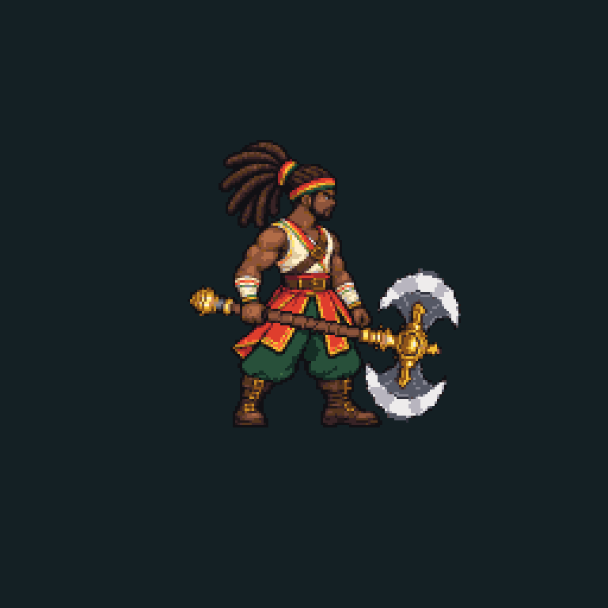
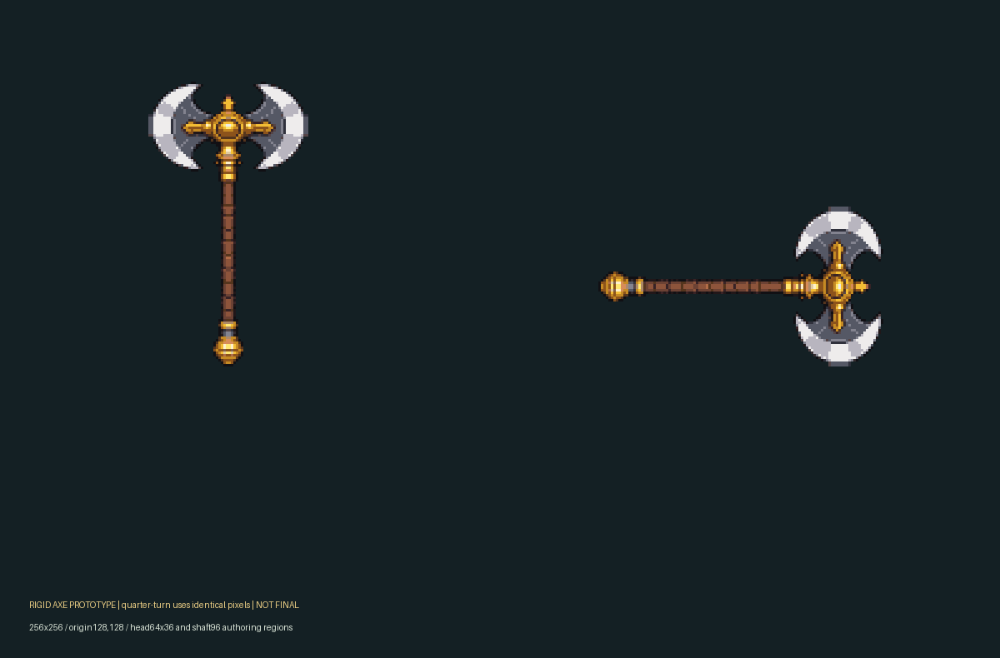

# Arma rígida e idle — protótipo2×, 2026-10-22

Rodrigo aprovou o alvo de aparência da prova anterior: “Sim, usar esse visual como base”. OWNER_APPEARANCE_APPROVAL.json identifica exatamente o PNG e o escopo. Isso permite continuar a produção; não registra aceite da arma nova, clips finais, paleta em cenário, direitos ou revisão no aparelho.

## Entregas

- Machado independente em256×256, cabeça visível64×36, eixo/cabo96px; marcadores de origem/pega/centro no MANIFEST.json.
- Duas orientações do mesmo desenho, com90graus comprovados por transposição dos mesmos pixels; a pose carregada usa mais12graus e nearest-neighbor. Não são dois desenhos generativos chamados de rotação.
- Fontes em camadas PNG: cabeça, cabo, corpo neutro, torso, pernas/base, arma posicionada, lâminas e oclusão da mão.
- Idle experimental: quatro momentos de200ms, três poses de rig,800ms por loop. Pés e pega fixos; braço/mão cobrem o cabo; a lâmina não sobrepõe o corpo nos quatro frames.
- Atlas1024×256, frames individuais256×256, GIF de inspeção e prancha da arma.32cores opacas compartilhadas; alpha0/255.

## Método e limites

ImageGen integrado produziu duas fontes de1254×1254 e uma correção de mesmo tamanho. Os prompts estão incluídos. As tentativas de quatro poses apresentam deriva de base/pés/arma; a correção removeu a arma, mas os quatro desenhos ainda não constituem uma animação consistente. Essas folhas são fontes de estudo, não um atlas promovido ao jogo.

O pacote usa **apenas a primeira pose desarmada nova** como base para um rig de respiração declarado. Torso sobe0/1/2/1pixel, com sobreposição de costura e base/mão fixas. Não são quatro poses desenhadas à mão. O export envolve redução BOX, paleta fixa selecionada no pacote anterior, alpha binário, reconstrução separada da cabeça/cabo do machado, simetria e duas colunas nativas de acabamento da borda. Nenhum desses procedimentos é apresentado como entrega nativa manual do ilustrador.

Execute build_pack.py para reconstruir e verify_pack.py para medir. Seis testes de falhas cobrem rotação redesenhada, pés deslocados, conjunto incompleto, canvas errado e alpha parcial, além do pacote real. VERIFICATION.json é integridade do protótipo, não aprovação automática. Anatomia, envelope dos dreadlocks, qualidade/fluidez das poses, consistência com demais clips e leitura em sala/celular continuam pendentes.

Nenhum arquivo foi promovido para game/assets. Não foi atribuído um SpriteFrames de produção ao Player: faltam os demais sete clips corporais e os efeitos/portal. O candidato Python antigo continua rejeitado. Original aprovado, fontes geradas e tentativas permanecem preservados; sem licença/aceite cultural presumidos. Próximo: corrigir/validar o idle com os demais clips e integrar um conjunto completo revisável, antes da Floresta/Chaser. Acabamento/áudio só após conclusão visual.
