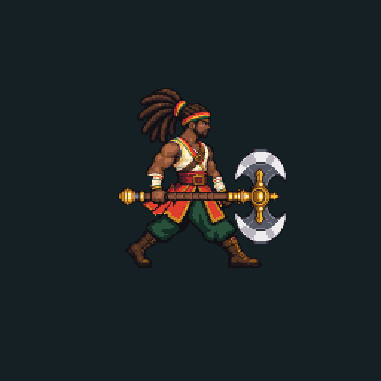

# Corrida por camadas — seis poses de pernas em protótipo

O alvo de aparência aprovado por Rodrigo continua como base. ImageGen produziu uma folha nova apenas da cintura para baixo (1536×1024, grade3×2), com seis poses de corrida. O torso/cabeça, braços/mãos e a arma vêm das camadas do pacote anterior, preservando identidade/pega. Isso é uma composição de camadas declarada, não seis desenhos completos novos nem um clip final aceito.

Método: um único fator de redução para as seis células; paleta32/alpha binário; marcos de quadril estimados por translação; correções de contato de1/1/0/2/2/0pixels nativos documentadas. Quatro poses de apoio têm borda dos pés y180; as duas de voo têm y175. Sem escala diferente por quadro. Torso tem bob0/1/2/0/1/2px; braços/pega ficam estáveis.

A arma do idle, inclinada102graus, cruzava a perna em passada larga. Na corrida usa-se a orientação rígida90graus, nivelada e idêntica em todos os seis frames. Nenhuma lâmina foi redesenhada ou redimensionada. O relatório verifica zero sobreposição lâmina/corpo e pega opaca em todos os frames.

Frames256×256, atlas1536×256,60ms por quadro/360ms por ciclo, renderização pretendida0.5. O tempo usa como referência a corrida atual260unidades/s e passada estimada46unidades por180ms; isso não comprova ausência de foot sliding ou sincronismo com velocidade/upgrades em jogo. Essa adaptação do presenter ainda está pendente.

Fontes/prompts, camadas separadas, script reproduzível, hashes, atlas/GIF/prancha e verificação incluídos. Execute build_run.py e verify_run.py. Passes são integridade do protótipo; proporções, ligação de cintura, alternância de pernas, massa da roupa, fluidez/loop e leitura no celular ainda precisam de limpeza/revisão. Os novos desenhos não recebem aceite automático por usarem um alvo aprovado.

Sem promoção para game/assets, alteração de gameplay, novo APK ou SpriteFrames final atribuído. Direitos, cultura final, QA Godot/Android e Gold continuam pendentes. Após esses protótipos de locomoção, faltam ataques terrestre/aéreo, hurt/death, efeitos/portal e o restante do kit visual. Acabamento/áudio segue posterior à conclusão visual.
