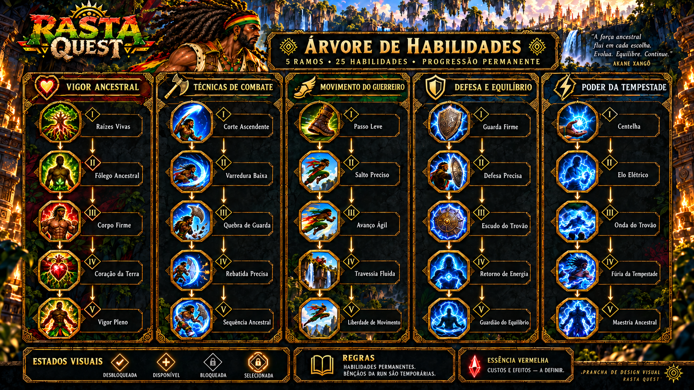

# Raízes do Trovão — árvore visual v02

Esta revisão substitui o ramo de melhorias do machado por **Técnicas de Combate**, conforme a orientação do usuário. Não duplica a aba de equipamentos.

## Separação dos sistemas

| Sistema | Conteúdo |
|---|---|
| Equipamentos / Machado | Cabo, lâmina, ponteira, aparência e melhorias da peça. Permanece no menu existente. |
| Habilidades permanentes | Técnicas de combate, vigor, movimento, defesa e tempestade. |
| Poderes da run | Bênçãos e efeitos temporários; não se tornam melhorias permanentes da árvore. |
| Búzios | Cinco reais por sala = uma vida extra; não são moeda para comprar habilidades. |

O ramo revisado tem **Corte Ascendente → Varredura Baixa → Quebra de Guarda → Rebatida Precisa → Sequência Ancestral**. Seus ícones representam ações, não novas peças de arma. Não há aumento numérico de dano ou compra de cabos nessa coluna.

[SKILL_TREE_DESIGN.json](SKILL_TREE_DESIGN.json) define os 25 nós, dependências e ligação com os [estudos de movimento](../combat-motion-v01/README.md). Nós passivos podem reutilizar pose/VFX existentes; não exigem 25 animações únicas. Nomes e efeitos são propostas, custos ainda indefinidos. Não há migração de save ou alteração de IDs no runtime.

A [v01](../skill-tree-v01/README.md) permanece preservada como versão anterior. Usar a v02 como referência visual atual. As duas vistas desta pasta mostram as mesmas 25 habilidades; a ordem no menu sobe da raiz para o topo e a lista de detalhe vai de I a V de cima para baixo.

As imagens foram revisadas visualmente quanto aos cinco ramos, 25 nós e troca da coluna. Continuam pranchas de design, não interfaces interativas. Arquivos de prompt e procedência acompanham as imagens. Legibilidade mobile, navegação real e revisão artística/cultural/de direitos seguem para produção. Tudo permanece em 2D; sem merge, build Unity ou release.
